# Baseline Generation Gallery — Stable Diffusion 1.5

Model `stable-diffusion-v1-5/stable-diffusion-v1-5` · 30 steps · guidance 7.5 · seed 42+i · 512×512

Mean CLIP score: generated **27.0** vs ground truth **24.4** · mean generated↔real image similarity **71.9**

| # | Domain | Prompt | Ground truth | Generated | CLIP (gen) | CLIP (GT) |
|---|---|---|---|---|---|---|
| 0 | animals | A tan dog running through the grass with the background blurry |  | 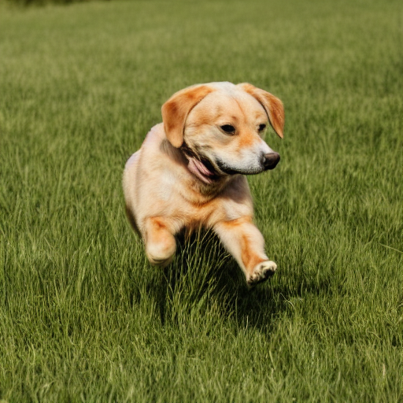 | 26.600000381469727 | 22.799999237060547 |
| 1 | animals | A dog with golden fur is chest deep in water |  | 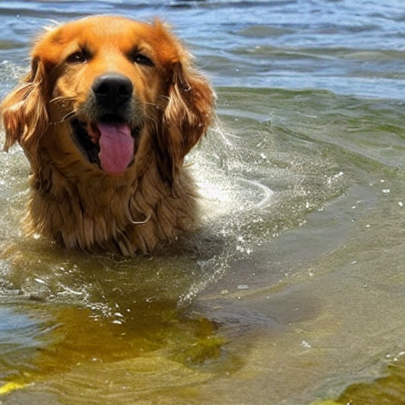 | 29.600000381469727 | 21.700000762939453 |
| 2 | sports | A man in a number ten jersey kicks a soccer ball while another team member watches |  | 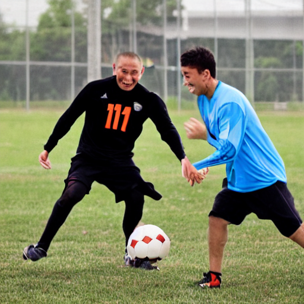 | 25.799999237060547 | 22.5 |
| 3 | sports | A person jumping their bike in the woods in front of trees with no leaves |  | 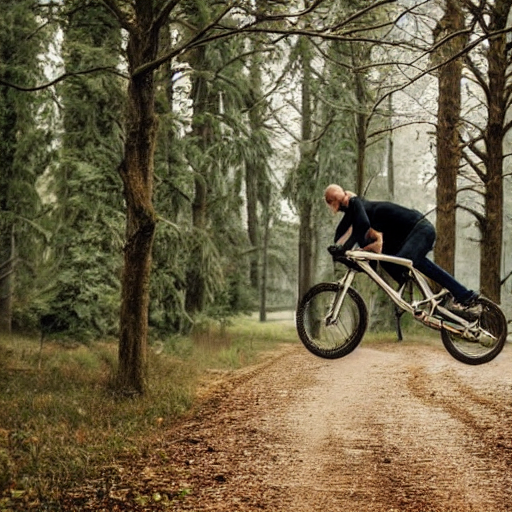 | 25.799999237060547 | 23.899999618530273 |
| 4 | water / beach | Men and women in bathing suits are standing at poolside while another swimmer is in the water |  | 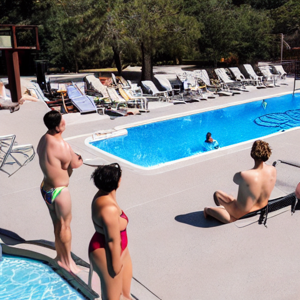 | 25.100000381469727 | 24.600000381469727 |
| 5 | water / beach | Boy heads into water big tents and hills in background in rural area |  | 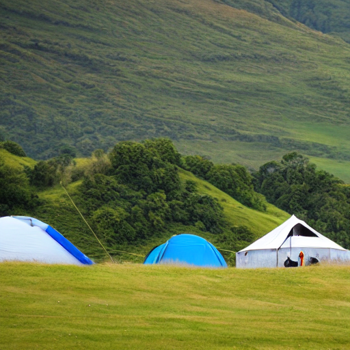 | 22.700000762939453 | 25.100000381469727 |
| 6 | city / street | Five people on bikes in traffic with man watching from the side of the road |  | 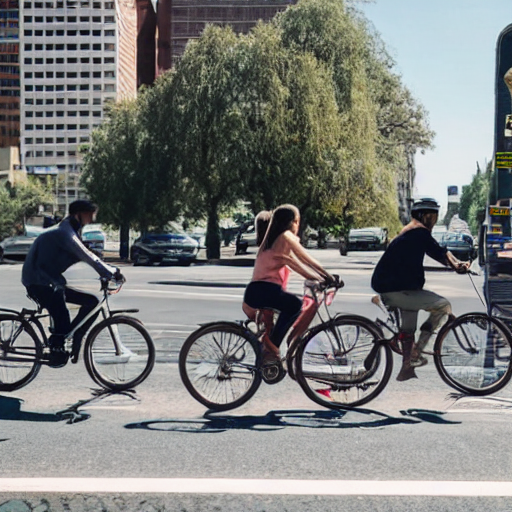 | 24.100000381469727 | 23.700000762939453 |
| 7 | city / street | People are walking on the slippery road in winter and there are two dogs: black and yellow |  | 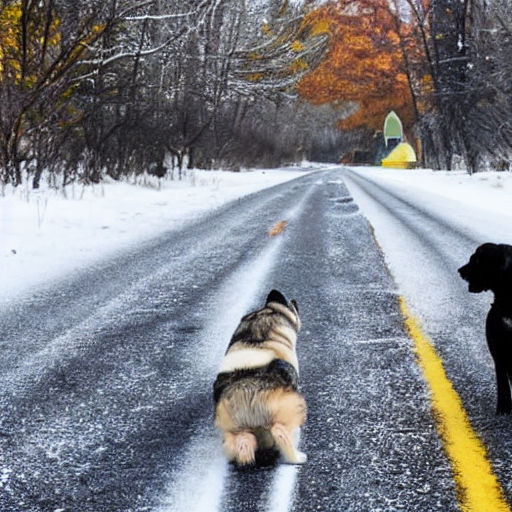 | 27.299999237060547 | 20.600000381469727 |
| 8 | nature | A couple and their child pose for a picture in front of a Christmas tree |  |  | 27.100000381469727 | 25.600000381469727 |
| 9 | nature | Three dogs who are brown white and black ( respectively ) play with one another in a dirt field |  | 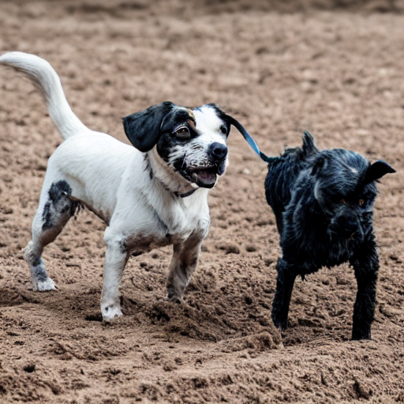 | 26.0 | 26.299999237060547 |
| 10 | indoor | Party goers at a rave dancing by a table with glow sticks on it |  | 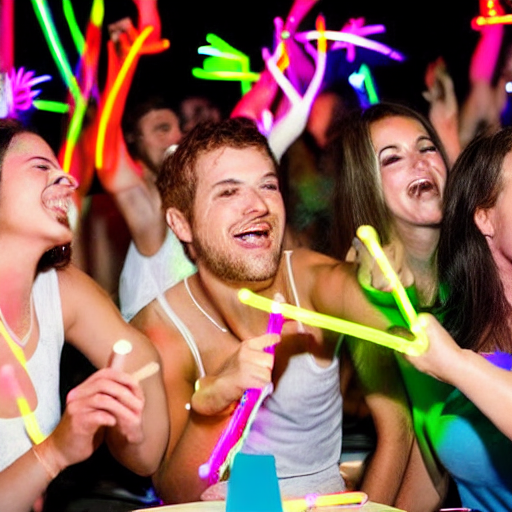 | 30.799999237060547 | 20.799999237060547 |
| 11 | indoor | Three women and a man sitting at a table with a large pitcher of beer |  | 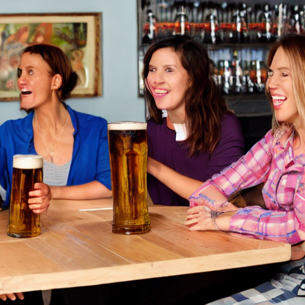 | 30.200000762939453 | 24.600000381469727 |
| 12 | people | A group of people ride a blue roller coaster on its way down from a turn |  | 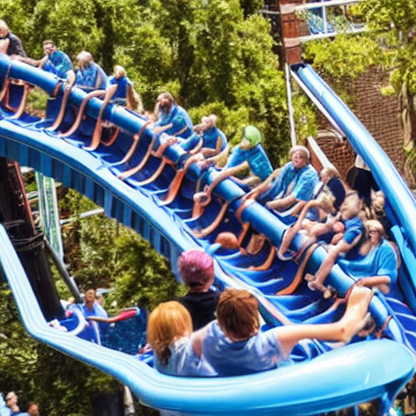 | 31.299999237060547 | 29.100000381469727 |
| 13 | people | A group of six children stands smiling and laughing in front of a wall |  | 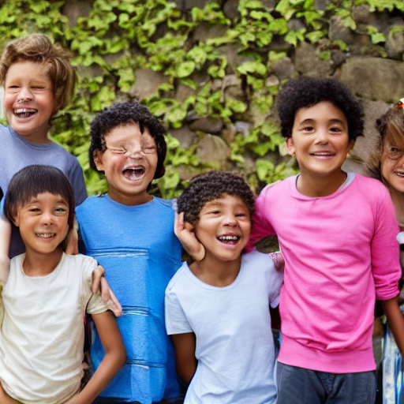 | 23.700000762939453 | 27.0 |
| 14 | other | One man in the back of a truck working on a farm with animals in the background |  | 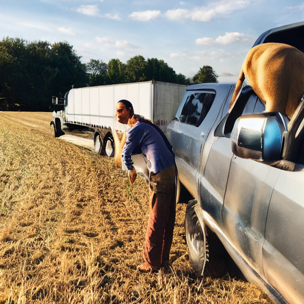 | 28.600000381469727 | 27.100000381469727 |

## Diversity test (same prompt, 4 seeds)

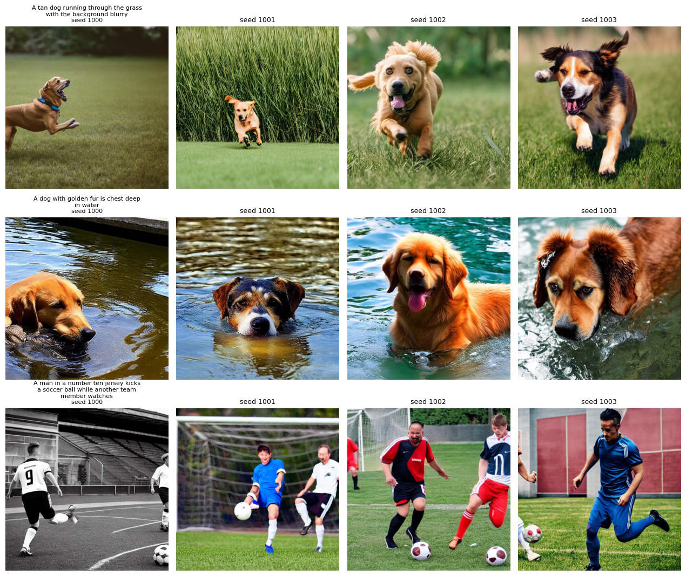

| Prompt | Mean pairwise image similarity |
|---|---|
| A tan dog running through the grass with the background blurry | 93.0 |
| A dog with golden fur is chest deep in water | 88.1 |
| A man in a number ten jersey kicks a soccer ball while another team member watches | 81.8 |

## Qualitative analysis

_(to be written from the results above)_